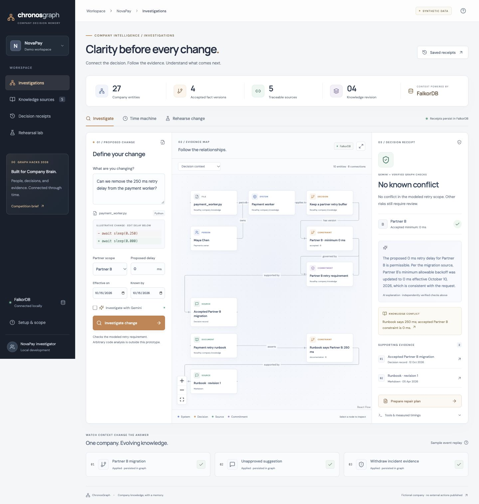
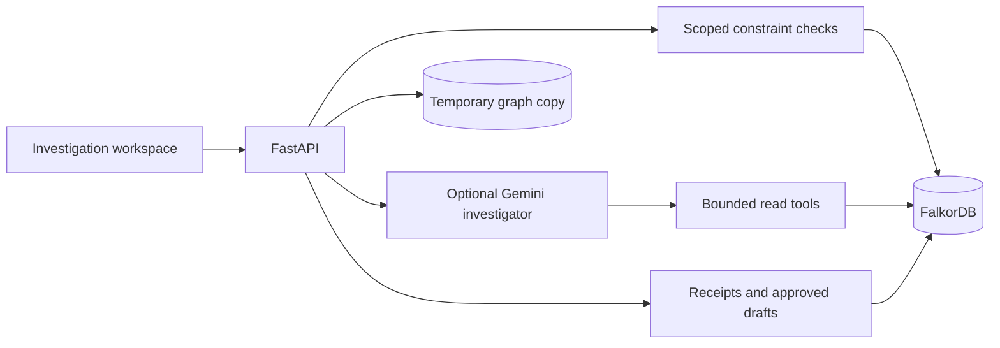

<p align="center">
  
</p>

<p align="center">
  <a href="https://github.com/VeerabhadraYerram/Chronos/actions/workflows/ci.yml">CI checks</a>
  &nbsp; <a href="LICENSE">MIT License</a>
  &nbsp; · &nbsp; Company Brain prototype
</p>

**Understand why a company requirement exists, when it applies, and what work is needed before changing it.** ChronosGraph connects decisions, people, commitments, and source evidence in FalkorDB. A Gemini investigator can explore that context through bounded read tools; explicit constraint checks determine the assessment.

**[Evaluate the demo](docs/EVALUATION.md)** · **[Architecture](docs/ARCHITECTURE.md)** · **[Graph model](docs/DATA_MODEL.md)** · **[API](docs/API.md)** · **[Validation](docs/VALIDATION.md)**

## The problem

A payment delay looks like an easy performance improvement. Its reason lives elsewhere: an incident review, a team decision, and a partner requirement. Later, one partner migrates and the old runbook becomes misleading.

ChronosGraph answers: **Which requirement applies to this change, what supports it, and who should review the next step?** It preserves the distinction between when a requirement applied and when the company learned about it.

<details>
  <summary><strong>View the actual investigation workspace</strong></summary>
  <br />
  
  <p>The local prototype using fictional NovaPay data. This screenshot shows a saved Partner B investigation after migration; it is not a live company integration.</p>
</details>

## What you can audit

| Capability | Observable behavior |
| --- | --- |
| Decision receipts | Inspect the accepted requirement, supporting excerpts, owner, relationship map, and measured tool trace. |
| Two timelines | Compare “what applied then” with “what we knew then,” including late-arriving migration evidence. |
| Knowledge conflicts | Detect a runbook claim that disagrees with an accepted requirement in the same partner scope. |
| Change rehearsal | Copy the real FalkorDB graph, evaluate a narrower proposal, and leave base knowledge untouched. |
| Work preparation | Generate a source-linked repair draft, download Markdown, and record in-app approval. |
| Persistent memory | Reopen saved receipts; changing company knowledge marks prior receipts stale. |

**Current scope:** one fictional payment worker, two partners, and a modeled minimum retry delay. Free text supplies context; the explicit partner, delay, and date controls define the assessed change. Data enters through the seed and labeled sample-event replay. Live ingestion, expertise discovery, and external action publishing remain planned.

## Run locally

Requirements: **Python 3.13**, **Node.js 20.19+**, **npm**, and **Docker with Compose**. Development was verified on macOS ARM64; CI is configured for Ubuntu. The image supports AMD64 and ARM64.

The repository is currently private. Cloning and reviewing CI require an authorized GitHub account until it is made public for submission.

```sh
git clone https://github.com/VeerabhadraYerram/Chronos.git ChronosGraph
cd ChronosGraph
docker compose up -d --wait
python3 -m venv .venv
.venv/bin/python -m pip install -r backend/requirements.lock.txt
npm --prefix frontend ci
./scripts/dev.sh
```

Open **[http://127.0.0.1:5173](http://127.0.0.1:5173)**. No Gemini key is needed for graph checks, history, rehearsal, or repair drafts. Startup seeds the configured graph once; it does not reset an existing workspace.

To enable the **Gemini agent**, copy `.env.example` to `.env` only if you do not already have one, add your own `GEMINI_API_KEY`, and restart the API. Then enable **Investigate with Gemini** in the interface. Keep the key server-side; `.env` is ignored. Model availability and quota depend on your account.

| Service | Local address |
| --- | --- |
| Interface | `http://127.0.0.1:5173` |
| API / interactive reference | `http://127.0.0.1:8000/docs` |
| FalkorDB | `127.0.0.1:6389` |

Stop development servers with `Ctrl+C`. `docker compose stop` preserves database data. Deleting the named volume deletes the local demo knowledge and receipts. [Setup, fresh workspaces, and troubleshooting →](docs/EVALUATION.md#setup-and-troubleshooting)

## Reproduce the result

On a fresh fixture, propose **0 ms for both partners**. Both requirements are initially 250 ms. Replay **Partner B migration** and investigate again: A still conflicts; B now meets its accepted minimum. The old runbook is flagged for B.

Then compare October 11 **as known on October 11** against the same date **using knowledge from October 15**. The migration took effect October 10 but was recorded October 12. [Full walkthrough and expected outcomes →](docs/EVALUATION.md)

For a repeatable audit without opening the UI or calling Gemini:

```sh
./scripts/check.sh
```

This runs the real FalkorDB integration suite, an isolated business-scenario evaluation, the production frontend build, and local documentation-link checks. Each evaluation creates and removes its own disposable graph. Your demo graph is preserved. [Individual commands and recorded evidence →](docs/VALIDATION.md)

## How FalkorDB shapes the answer



Accepted facts are selected by partner, effective time, and recorded time through parameterized graph queries. Sources and owners come from relationships. Receipts and in-app actions are written back to FalkorDB. The frontend's graph filter changes presentation only; it does not compute verdicts. [Follow the implementation →](docs/ARCHITECTURE.md#code-map)

## Scope and limitations

- **“No known conflict” is limited to the modeled retry requirement.** It does not establish deployment safety or inspect arbitrary code.
- **Source-ID validation is not semantic proof.** Gemini explanations still need review; they cannot override the deterministic assessment.
- **Ownership is implemented; expertise ranking is not.** Historical ownership and topology are not versioned.
- **Updates are replayed sample events.** There are no live Slack, GitHub, Jira, or Notion connectors.
- **Approval is local to the app.** No PR, message, ticket, merge gate, or production change is published.
- **This is a trusted local prototype.** Authentication, source-level permissions, crash-atomic ingestion, and multi-worker coordination are not implemented. [Security model →](SECURITY.md)

## Project and development

Built for the **Company Brain** track of [WeMakeDevs × FalkorDB Graph Hacks](https://www.wemakedevs.org/hackathons/falkordb). [Competition fit](docs/COMPETITION_FIT.md) maps the brief to code, evidence, and remaining work. NovaPay and its sources are synthetic. Implementation began October 15, 2026, using public libraries and AI coding assistance; the builder remains responsible for understanding and explaining the code.

Start with [contributing guidance](CONTRIBUTING.md), [architecture](docs/ARCHITECTURE.md), and [the implementation roadmap](docs/ROADMAP.md). The [original planning blueprint](docs/planning/MASTER_PLAN.md) is retained as design history, separate from implemented capabilities.

## License

ChronosGraph source and documentation are available under the [MIT License](LICENSE). Third-party packages, FalkorDB, and external model services retain their respective licenses and terms.
