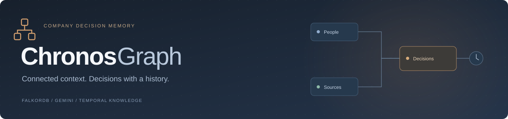
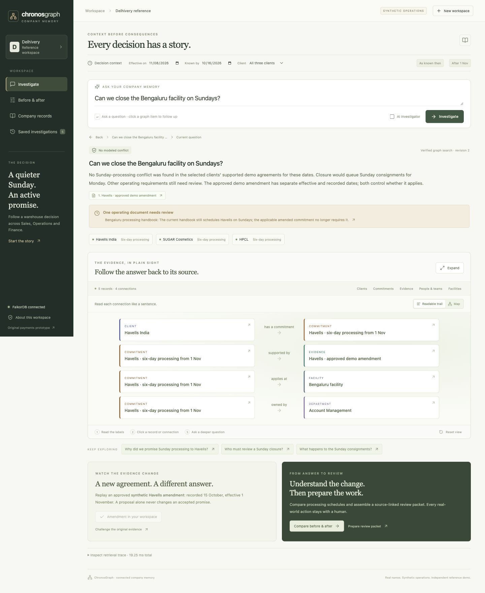
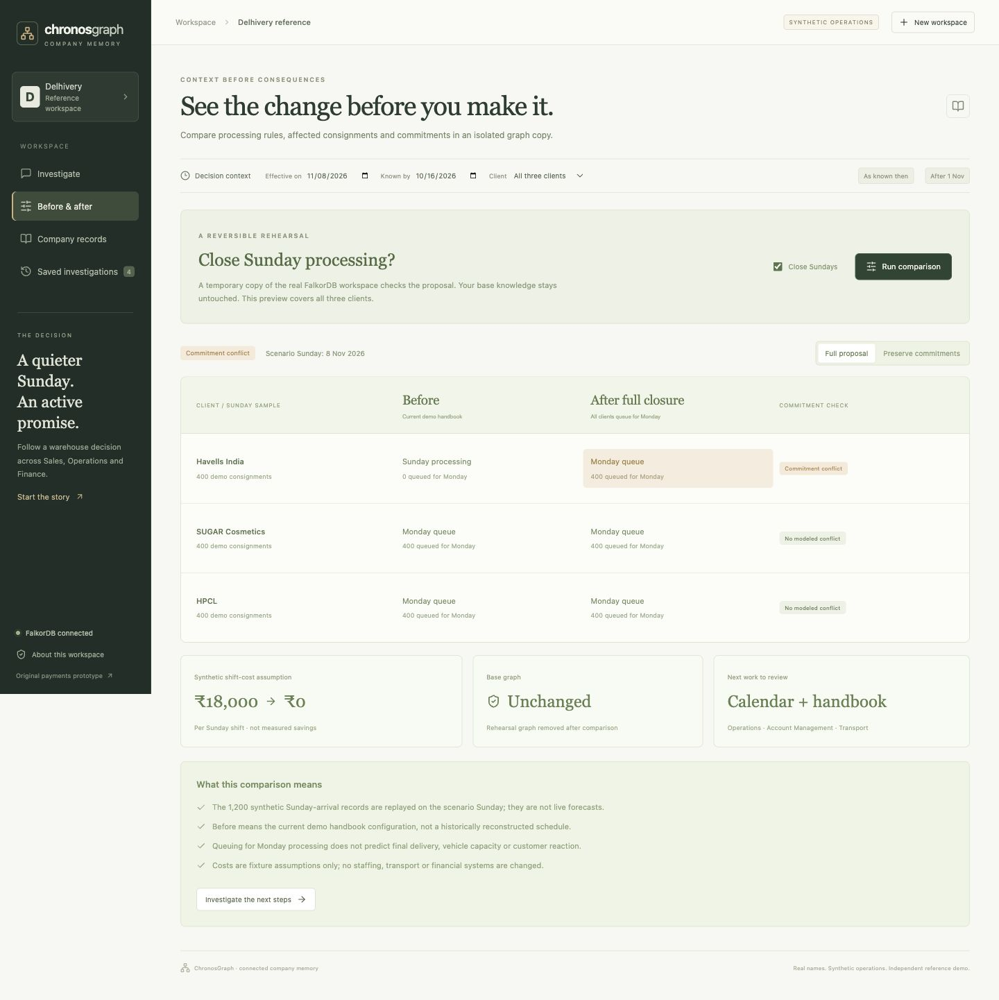
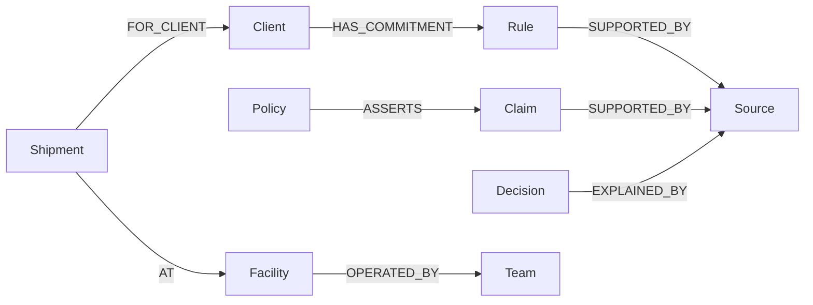
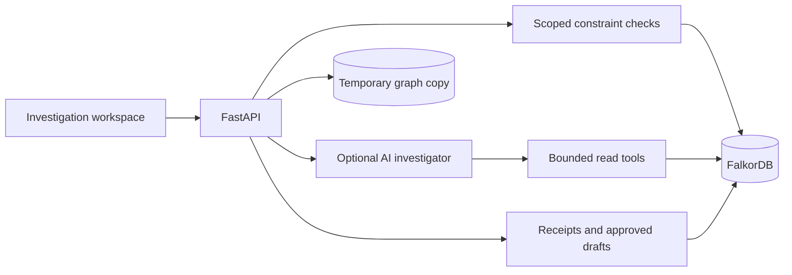

<p align="center">
  
</p>

<p align="center">
  <a href="https://github.com/VeerabhadraYerram/Chronos/actions/workflows/ci.yml">CI checks</a>
  &nbsp; <a href="LICENSE">MIT License</a>
  &nbsp; · &nbsp; Company Brain prototype
</p>

**Ask why a company decision exists. Check whether it still applies. Follow the evidence, then compare the proposed change.**

ChronosGraph is an interactive company-memory investigator powered by **FalkorDB** and an optional **Groq / Gemini / OpenRouter** tool loop. Its core investigates records across company departments. A guided logistics fixture demonstrates one understandable decision: **can the Bengaluru facility close on Sundays?**

**[Live website](https://chronosgraph.onrender.com)** · **[Live database inspection](https://chronosgraph.onrender.com/database)**

**Judges: [submission requirements and evidence](docs/SUBMISSION.md)** · **Track 03: Company Brain** · Demo video: pending

[Documentation index](docs/README.md) provides reading paths for evaluators and developers, including current implementation and preserved planning material.

**[Separate database inspection](docs/INSPECTION.md)** · **[Company-wide engine](docs/COMPANY_ENGINE.md)** · **[Explore the reference demo](docs/DELHIVERY_REFERENCE.md)** · **[Database & schema](docs/DATABASE.md)** · **[Cypher queries](docs/GRAPH_QUERIES.md)** · **[Evaluate locally](docs/EVALUATION.md)** · **[Competition fit](docs/COMPETITION_FIT.md)** · **[Validation](docs/VALIDATION.md)**

## The story

Operations wants Sunday closure. Sales has recorded a Havells commitment. Account Management later records an amendment. The old handbook has not caught up. Finance has staffing assumptions. ChronosGraph connects the records so a reviewer can understand the active promise, inspect its reason and sources, and rehearse a scoped alternative.

**The workspace uses real company and client names. All private operational records, agreements, employee roles, costs and policies here are synthetic.** This is an independent reference demo informed by public logistics documentation, not Delhivery's actual internal system, private database schema or an affiliated product. [Public references and exact boundaries](docs/DELHIVERY_REFERENCE.md#public-facts-versus-synthetic-records).

## What you can do

- Ask a free-text question; inspect a small graph-derived evidence trail or spatial map.
- Click a record or relationship, inspect provenance, expand connections and ask contextual follow-ups.
- Compare effective time with knowledge time; approved sample amendments preserve the earlier belief.
- Rehearse full Sunday closure versus preserved client exceptions in a **real FalkorDB graph copy**.
- Inspect before/after processing, queued sample consignments and explicitly synthetic cost assumptions.
- Search a graph containing **9,991 initial entities and 17,207 relationships**, including 1,890 consignments and 6,870 tracking events across multiple operational states.
- Reopen saved investigations and download a review packet (local volume-backed storage persists; the free-hosted instance resets on restart). No real company action is published.

Each visitor gets a separate demo graph. The selected AI provider uses bounded read tools when enabled; graph-only mode shows stored facts/excerpts when AI is disabled; if every configured provider fails, the interface explicitly says no AI answer was generated. The guided scheduling simulator retains deterministic checks. Unfamiliar questions are limited by the recorded evidence; this is not unrestricted enterprise question answering.

<details>
  <summary><strong>View the actual investigation and comparison workspace</strong></summary>
  
  
  <p>Captured local UI states. Real organization names; synthetic operating records and agreements.</p>
</details>

## Run locally

Requirements: **Python 3.13**, **Node.js 20.19+**, **npm**, and **Docker with Compose**. Development was verified on macOS ARM64; CI is configured for Ubuntu. The image supports AMD64 and ARM64.

The repository is public for judge review.

```sh
git clone https://github.com/VeerabhadraYerram/Chronos.git ChronosGraph
cd ChronosGraph
docker compose up -d --wait
python3 -m venv .venv
.venv/bin/python -m pip install -r backend/requirements.lock.txt
npm --prefix frontend ci
./scripts/dev.sh
```

Open **[http://127.0.0.1:5173](http://127.0.0.1:5173)**. No AI-provider key is needed for graph checks, history, rehearsal, or repair drafts. The main workspace copies a separate reference seed into a visitor graph; it does not reset an existing workspace. The preserved NovaPay prototype is available at `/?demo=payments`.

To enable the **AI investigator**, copy `.env.example` to `.env` only if you do not already have one, add your own provider key, and restart the API. The main interface enables **AI investigator** when a provider key is configured. Groq is preferred when `GROQ_API_KEY` is configured (`GROQ_MODEL=openai/gpt-oss-120b`); Gemini is the backup. Groq uses bounded structured read plans validated by the server; Gemini uses native function calls. An optional `OPENROUTER_API_KEY` adds `openrouter/free` as a final fallback; paid OpenRouter model IDs are rejected. The receipt identifies the provider that actually completed the run. Keep the key server-side; `.env` is ignored. Model availability and quota depend on your account.

| Service | Local address |
| --- | --- |
| Interface | `http://127.0.0.1:5173` |
| Separate database inspection | `http://127.0.0.1:8000/database` |
| API / interactive reference | `http://127.0.0.1:8000/docs` |
| FalkorDB | `127.0.0.1:6389` |

Stop development servers with `Ctrl+C`. `docker compose stop` preserves database data. Deleting the named volume deletes the local demo knowledge and receipts. [Setup, fresh workspaces, and troubleshooting →](docs/EVALUATION.md#setup-and-troubleshooting)

## Reproduce the result

Select **Guided walkthrough**, then ask about Sunday closure in a fresh workspace. Inspect the Havells commitment and its evidence. Replay the approved synthetic amendment, then rerun before and after November 1 using different knowledge cutoffs. Compare full closure with a commitment-preserving alternative. [Step-by-step walkthrough](docs/DELHIVERY_REFERENCE.md#start-and-explore).

For a repeatable audit without opening the UI or calling an external AI provider:

```sh
./scripts/check.sh
```

This runs the real FalkorDB integration suite, an isolated business-scenario evaluation, the production frontend build, and local documentation-link checks. Each evaluation creates and removes its own disposable graph. Your demo graph is preserved. [Individual commands and recorded evidence →](docs/VALIDATION.md)

## How FalkorDB shapes the answer

The core graph data model connects business records to their authority, provenance and owners:



Rules carry effective and recorded time intervals; source records hold original excerpts. This is a selected model view, not the complete schema. See the [full data dictionary](docs/DATABASE.md), [machine-readable schema](docs/database-schema.json), and [actual Cypher queries](docs/GRAPH_QUERIES.md).

The request path is:



Applicable rules are selected from retrieved subjects and source evidence at the selected effective and recorded times. Generic search, ownership, schema discovery and database aggregations work with imported company records. Sources and owners come from relationships. Receipts and in-app actions are written back to FalkorDB. The frontend's graph filter changes presentation only; it does not compute verdicts. [Follow the implementation →](docs/DELHIVERY_REFERENCE.md#architecture-and-api)

## Scope and limitations

- **The general investigator is not an arbitrary change simulator.** Scenario predictions require an explicit model; graph excerpts and LLM prose are not operational approval.
- **“No modeled conflict” in the guided simulator covers the selected Sunday-processing commitments.** It does not establish logistics feasibility, final delivery dates or production safety.
- **Source-ID validation is not semantic proof.** AI explanations still need review; they cannot override the deterministic assessment.
- **Ownership is implemented; expertise ranking is not.** Historical ownership and topology are not versioned.
- **Updates are replayed sample events.** There are no live Slack, GitHub, Jira, or Notion connectors.
- **Review packets are local drafts.** No message, ticket, agreement or operating schedule is published.
- **This is an evaluation prototype.** Local development and the bounded public deployment do not implement enterprise authentication, source-level permissions, crash-atomic ingestion or multi-worker coordination. [Security model →](SECURITY.md)

## Project and development

Built for the **Company Brain** track of [WeMakeDevs × FalkorDB Graph Hacks](https://www.wemakedevs.org/hackathons/falkordb). [Competition fit](docs/COMPETITION_FIT.md) maps the brief to code, evidence, and remaining work. All private operating records are synthetic, including the preserved NovaPay example. Implementation began October 15, 2026, using public libraries and AI coding assistance; the builder remains responsible for understanding and explaining the code.

Start with [contributing guidance](CONTRIBUTING.md), [architecture](docs/ARCHITECTURE.md), and [the implementation roadmap](docs/ROADMAP.md). The [original planning blueprint](docs/planning/MASTER_PLAN.md) is retained as design history, separate from implemented capabilities.

## License

ChronosGraph source and documentation are available under the [MIT License](LICENSE). Third-party packages, FalkorDB, and external model services retain their respective licenses and terms.

See [Synthetic logistics depth](docs/DATA_SCENARIOS.md) for the expanded dataset, connected investigation examples and what remains simulated.

## Live evaluation deployment

The [Render Blueprint](render.yaml) packages the frontend, Python API and an internal FalkorDB instance on one Free service. Follow [deployment steps](docs/DEPLOYMENT.md) and the [submission release checklist](docs/SUBMISSION.md). The hosted app and live AI runs have been verified; see the dated [validation record](docs/VALIDATION.md) for observed behavior and free-hosting limitations.
