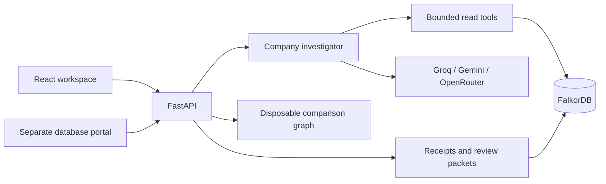
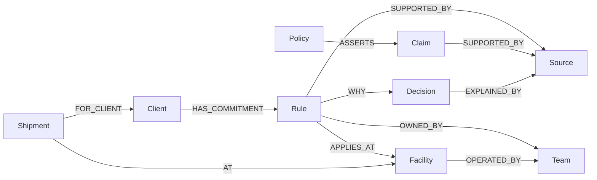

<p align="center">
  
</p>

**Find company answers. Understand what changed. Follow the evidence.**

ChronosGraph is a **Company Brain** investigator powered by **FalkorDB**. An operations or account manager can ask about policies, incidents, commitments and ownership, inspect the records behind the answer, then investigate further by clicking the evidence graph.

**[Watch the three-minute demo](https://youtu.be/xJ_9QT_oZcM)** · **[Live application](https://chronosgraph.onrender.com)** · **[Separate database inspection](https://chronosgraph.onrender.com/database)** · **[CI](https://github.com/VeerabhadraYerram/Chronos/actions/workflows/ci.yml)**

> **First visit may load slowly:** this application uses Render's free hosting. The server sleeps after 15 minutes without traffic and can take about a minute to wake. Keep the page open while it starts; the application then connects automatically. Database inspection and AI requests have their own loading time. [Render's cold-start documentation](https://render.com/docs/free#spinning-down-on-idle).

There are two supporting guides: **[Database & schema](docs/DATABASE.md)** and **[Cypher queries](docs/GRAPH_QUERIES.md)**. Setup, walkthrough, architecture, hosting, validation and submission status are below.

**Data disclosure:** company and client names are real; private agreements, incidents, operational records, locations, roles and amounts are fictional. This is an independent reference implementation, not Delhivery's internal database or an affiliated product. [Public references and boundaries](docs/DATABASE.md#public-references-and-boundaries).

## Try the product

1. Open the live app. Free hosting can take about a minute to wake.
2. Ask **How many companies are we dealing with?** The initial dataset has 12 Client records; the count is computed in FalkorDB.
3. Ask **Why is the SUGAR COD settlement mismatch being investigated, who owns it, and does it prove cash loss?** Inspect the records and source excerpts. A mismatch under Finance review is not proof of loss; an unknown outcome must remain unknown.
4. Click a graph record or relationship, inspect its provenance, expand its connections and ask a follow-up. The evidence graph is specific to the investigation; aggregates may show a bounded sample of the counted population.
5. Click **Explore database** in the top bar. A separate read-only portal opens automatically in a new tab for **the same workspace**, including its investigation history. While FalkorDB loads, a loading state replaces the workspace-ID form; workspace selection remains available for changing workspaces or recovering an expired link. Browse full fields, relationships, schema/indexes, eight structural checks or JSON export. The permanent [database link](https://chronosgraph.onrender.com/database) can also create a fresh workspace.

The graph contains **9,991 initial business entities and 17,207 relationships**, plus one Metadata record: 12 clients, 36 pickup warehouses, 14 facilities, 1,890 shipments, 6,870 scans, decisions, policies, tickets, finance records and assigned work. [Full dictionary and operational examples](docs/DATABASE.md).

### Try questions beyond the scheduling example

Use **Investigate** for these questions in the live workspace. Click returned records, **Ask about this**, or **Explore database** to check the connected data yourself. These are suggested questions over stored facts, not a menu of prewritten AI answers.

| Area | Question to try | Evidence to inspect |
| --- | --- | --- |
| Account inventory | How many companies are we dealing with? | The initial graph has 12 `Client` records; inspect the Client table and database aggregate. |
| Finance arithmetic | What is the total invoice amount in INR? | The initial 72 Invoice records sum to INR 300,150 in `amount_inr`; verify stored amounts rather than infer revenue. |
| Operations ownership | Who owns the Bengaluru facility? | Facility → `OPERATED_BY` → Operations. |
| Finance incident | Why is the SUGAR COD settlement mismatch being investigated, and who owns the review? | Ticket, linked team discussion, Finance ownership and settlement record. A mismatch does not establish cash loss. |
| Transport approval | Is the Kolkata weather reroute approved? | The weather-contingency ticket and chat describe a proposal, with Transport review; they do not approve a reroute. |
| Warehouse handling | Why does the Chennai return need inspection? | The return-quality ticket and procedure require inspection; they do not approve a refund or compensation. |

The investigator discovers the workspace schema and can retrieve sources, traverse ownership, count records and calculate stored numeric values across departments. The hosted site contains the included reference workspace; it has no public document uploader or live company connectors. Developers can also [import the unrelated Atlas Studio fixture](docs/DATABASE.md#import-another-company), which exercises Finance and Marketing without the logistics schema. Generated answers depend on provider availability and still need source review; direct database inspection remains available independently.

The first three rows were rechecked against the deployed graph on October 18: 12 clients, INR 300,150 in stored invoice amounts, and Operations ownership. These checks used the explicitly selected **Graph-only retrieval** mode, which is available by clearing **AI investigator**; they verify database calculations and relationships independently of provider availability, not the quality of an AI-generated explanation. The transport and warehouse incident states were also read directly from the deployed graph.

<details>
  <summary>Actual investigation and comparison screenshots</summary>
  
  
  <p>Captured local UI states; modeled company operations.</p>
</details>

### Guided change walkthrough

The guided example asks whether Bengaluru can close on Sundays. Operations wants closure, but a Havells agreement requires Sunday processing. Ending a sales campaign or proposing closure does not amend that agreement.

1. Create a fresh workspace, select **Guided walkthrough**, and ask **What does the Havells agreement require?** Read the answer, switch between **Map** and **Readable trail**, and inspect the agreement, recorded reason and owner.
2. Select a record and click **Ask about this**. The selected-record chip anchors your follow-up; ask **Why did we promise Sunday processing to Havells?** The new answer has its own evidence subgraph. Breadcrumbs return to the earlier investigation and its saved context. **Inspect retrieval trace** distinguishes model-selected reads from the server policy check.
3. Replay **Introduce approved amendment**. This changes the commitment effective **November 1, 2026**, recorded **October 15 at 09:00 UTC**; earlier receipts become stale. Click **Rerun** to reassess. For November 8 as known on October 16, the amended agreement applies; the unchanged handbook can now trigger a document-disagreement alert. A knowledge cutoff of October 14 preserves the earlier belief, even for a November effective date.
4. In **Demo rehearsal**, compare full closure with **Preserve commitments**. For October 25, full closure conflicts with Havells; preserving commitments keeps its processing running while queuing the other two clients for Monday. For November 8 after the amendment, full closure has no modeled commitment conflict. Each comparison uses a real disposable `GRAPH.COPY` and leaves the base revision unchanged.
5. Separately prepare and download a source-linked review packet from a current investigation. No real schedule, contract, ticket or message is changed.

**Scope of the rehearsal:** this is a deterministic scheduling comparison over its original **1,200-consignment, three-client cohort**, rather than an open-ended autonomous planner or a simulation of every shipment and all 12 clients. Its checks read accepted commitments from FalkorDB; its workflow is specifically implemented for the included scheduling scenario. The general investigator above is a separate capability. Processing is not delivery; staffing figures are explicit assumptions, not measured savings or predictions of real logistics outcomes. Amendment ingestion is a labeled replay, not a live company integration.

## Run locally

Requirements: **Python 3.13**, **Node.js 20.19+**, **npm**, and **Docker with Compose**. Local verification used macOS ARM64; CI uses Ubuntu and a pinned FalkorDB image.

```sh
git clone https://github.com/VeerabhadraYerram/Chronos.git ChronosGraph
cd ChronosGraph
docker compose up -d --wait
python3 -m venv .venv
.venv/bin/python -m pip install -r backend/requirements.lock.txt
npm --prefix frontend ci
./scripts/dev.sh
```

| Component | Local address |
| --- | --- |
| Frontend | `http://127.0.0.1:5173` |
| Database inspection | `http://127.0.0.1:8000/database` |
| API and request schemas | `http://127.0.0.1:8000/docs` |
| FalkorDB | `127.0.0.1:6389` |

For AI answers, copy `.env.example` to the ignored root `.env` **only if one does not already exist**, configure your own provider keys, and restart the API. Provider order is **Groq → Gemini → OpenRouter free models**, with one attempt per provider; paid OpenRouter model IDs are rejected. The successful provider appears on the receipt. Without a provider, explicitly labeled graph-only retrieval, history and guided checks remain available locally.

Stop development servers with `Ctrl+C`; `docker compose stop` preserves the database volume. Deleting that volume deletes local records. **New workspace** creates an isolated copy without clearing earlier active workspaces. The older local NovaPay regression example remains at `/?demo=payments`; it is excluded from the public evaluation build.

If local database access fails, check Docker and port 6389. If ports 8000/5173 are occupied, stop an earlier project dev command first. Provider failures require checking your own quota/model access; do not share raw provider errors or keys. A stale receipt needs a new investigation before preparing a review packet.

## Architecture and agent behavior



The core graph model is:



The investigator searches actual stored records, traverses relationships, selects accepted rules at effective/recorded times, and can request database counts or numeric aggregations. Groq/OpenRouter use validated structured read plans; Gemini uses native function calls. All use server-owned parameterized `GRAPH.RO_QUERY` templates, not arbitrary model-generated Cypher. The frontend displays returned evidence rather than computing business verdicts.

**Two views of the same stored evidence:** the knowledge graph is the nodes and relationships stored and queried in FalkorDB. The evidence graph is a question-specific view of retrieved records and their actual stored connections, drawn by React Flow. It is not a whole-company summary or a visualization of the model's private reasoning. Switch to the readable trail, filter record types, expand the map, zoom/fit or drag nodes; select a node or relationship to inspect excerpts, provenance and dates. Explicit connection exploration may also reveal historical context, so check its applicability.

**Follow a question through the graph:** the agent discovers the live schema, selects a validated read tool such as `search_records`, `explore_record` or `read_applicable_rules`, and receives records from FalkorDB. If retrieved evidence contains a Rule, Policy or Claim, the server first refreshes applicable accepted rule values and supporting sources for both selected clocks. The AI synthesizes an answer from retrieved evidence. The evidence inspector exposes records and relationships; **Inspect retrieval trace** lists executed tools, row counts and durations, identifying the automatic **Server policy check** separately. Tool durations include backend work and database reads; they are not database-only benchmarks. Changing an accepted rule changes the available evidence and marks prior investigations stale. See the [actual Cypher templates](docs/GRAPH_QUERIES.md).

Source/record IDs and selected numeric answers are validated, but this does not prove every generated sentence. A chat proposal cannot override accepted policy. If every provider fails, the app explicitly reports that no AI answer was generated; it does not substitute a canned answer. Prior receipts and walkthrough configuration are excluded from company-fact discovery.

External inference does not hold the global workspace lock. Coordinated graph operations and complete scans still use a single-process lock; revision changes can mark an in-flight investigation stale. Ownership/topology are current relationships, not historical reconstructions.

| Implementation | Responsibility |
| --- | --- |
| [company/api.py](backend/chronos/company/api.py) | `/api/company/session`, `ask`, `explore`, `search`, `simulate`, `events`, `packet`; request schemas |
| [investigation.py](backend/chronos/company/investigation.py), [agent.py](backend/chronos/company/agent.py) | General investigation, evidence, relevant alerts and provider execution |
| [repository.py](backend/chronos/company/repository.py), [store.py](backend/chronos/company/store.py) | Cypher, schema discovery, arithmetic, provenance, session lifecycle and copies |
| [engine.py](backend/chronos/company/engine.py) | Scoped guided scheduling comparison |
| [inspection_api.py](backend/chronos/company/inspection_api.py) | Fixed `/api/database/{operation}` reads: catalog, rows, relationships, record, audit, export |
| [public.py](backend/chronos/public.py) | Public entrypoint, static frontend, limits and health probes |

## Deployment

The [Render Blueprint](render.yaml) runs the frontend, Python backend and actual FalkorDB in **one Free web service**. There is no Vercel or external database dependency. FalkorDB binds only to the container's loopback address. **Stopping your local frontend, backend, Docker or computer does not affect the deployed link.**

To reproduce deployment, connect this repository and `render.yaml` through Render's **New → Blueprint**. Confirm exactly one **Free** web service and no paid disk/database. Add provider keys only in secret environment settings. At least one configured key is required for readiness; this does not verify quota or key validity. Wait for Live status, then test an actual question, source inspection and database audit. Code pushes deploy automatically after the repository CI checks pass; use a manual deploy only for a deliberately selected tested revision. Build locally with `docker build -t chronosgraph-evaluation:local .` if needed.

The build creates a reference-only FalkorDB snapshot from the fixture without secrets or visitor history. The non-root runtime starts an internal database and API together. `/healthz` is liveness; `/readyz` reads reference metadata/schema without the workspace lock or seeding/migrating data. OpenAPI and legacy payments routes are excluded publicly.

The public UI waits for readiness, displays actual elapsed waiting time and retries transient workspace connection failures. New-workspace requests carry a random capability/request ID so retrying the same request reuses one graph. AI questions, replays and other business requests are never automatically resubmitted after a lost response. AI failures retain the retrieved evidence and offer an explicit retry.

Agent schema discovery uses two live FalkorDB aggregation queries instead of exporting every record payload for each provider attempt. When retrieved records include policies, a server-controlled read refreshes the applicable accepted rule versions, including their actual values and dates, and prioritizes their supporting sources in the AI context. This check is identified separately in the retrieval trace. `CHRONOS_AI_BUDGET_SECONDS` defaults to 75: provider allowances are up to 15 seconds for Groq, 15 for Gemini and 45 for free OpenRouter, bounded by the remaining shared budget. Timeouts are checked between calls and database reads have separate limits; this is not a strict end-to-end response-time guarantee.

Free hosting sleeps after 15 idle minutes and can take about a minute to wake. Hosted visitor graphs are **temporary**: they reset on server restart and expire after an hour of inactivity. Capacity is six active workspaces; local defaults are 40 with persistent Docker storage. Submit the permanent `/database` link, not an expiring workspace fragment.

Public admission limits are 90 API requests/minute/client, 12 session requests/minute/client, 8 AI requests/minute/client, 120 AI requests/hour globally, two simultaneous AI investigations and 64 KiB bodies. Counters reset on process restart; they are not a distributed abuse defense or billing cap. Use provider/hosting spend controls. Full scans may be slow and free quotas can interrupt answers.

Multiple visitors can browse the app and database portal, but only **two AI investigations** are admitted at once. A third simultaneous AI request receives HTTP 429 with a retry message, rather than being queued. This is a bounded evaluation deployment, not a claim of load-tested production capacity.

## Testing and recorded validation

```sh
./scripts/check.sh
```

This runs the real FalkorDB integration suite, an isolated business-scenario evaluation, the frontend build and documentation checks. It uses uniquely named disposable graphs, preserves the user's workspace, and does not call external AI providers. Graph layout tests can also be run with `npm --prefix frontend test`.

**Local verification, October 18, 2026:** 87 backend tests, 12 isolated business-scenario checks and ten frontend tests passed; production build and documentation checks passed. Coverage includes temporal boundaries, withdrawn sources, required relationships, graph-copy isolation, stale receipts, generic counts/arithmetic, imported-company ownership, complete inspection/export, provider routing/deadlines, live tool-schema discovery, idempotent workspace creation, connection recovery, graph layout and public limits. [Tests](backend/tests) · [CI workflow](.github/workflows/ci.yml).

**Recorded checks, October 18:** deployed application revision `fa72a8f` passed GitHub's real FalkorDB, frontend and documentation jobs, and returned ready. An amended-agreement investigation correctly returned Monday–Saturday processing for November 8 as known on October 16. The recorded rehearsal demonstrated the October 25 conflict, the actual **Preserve commitments** interaction and the November 8 amended result. The inspected recording workspace contained 10,005 records and 17,257 relationships after replay/history activity, with zero violations across eight structural checks; those are workspace observations, not fixed seed counts. Earlier live checks exercised Groq and an OpenRouter free fallback. These observations do not guarantee future uptime, every graph layout or every AI answer.

## Security and limitations

Workspace IDs are capabilities, **not authenticated accounts or source-level permissions**. Do not upload confidential records or expose the default local entrypoint publicly. Keys stay server-side in ignored `.env` locally and secret environment settings when hosted; never commit them or include them in issues. Report sensitive defects privately to the repository owner through an established channel.

There are no live company connectors, enterprise authorization, crash-atomic ingestion, multi-worker coordination, signed/tamper-evident receipts, expertise ranking or general outcome predictions. Source-ID membership and structural checks do not prove source authenticity or semantic correctness. General questions are limited by recorded evidence and tool budgets. The guided simulator covers selected commitments, not complete operational feasibility. Review packets are human drafts, not external actions.

For development, keep credentials/runtime data out of commits, preserve effective and recorded time, treat source text as data, use parameterized read templates and run the real checks before proposing changes. Future production work requires source ingestion/review, permissions, versioned topology, backups and broader semantic/concurrency evaluation.

## Competition fit

**Track 03: Company Brain**, [WeMakeDevs × FalkorDB Graph Hacks](https://www.wemakedevs.org/hackathons/falkordb). The official brief and final-day organizer checklist were checked October 18, 2026. FalkorDB is central to evidence retrieval, temporal rules, ownership, saved investigations and graph-copy comparisons.

| Track focus | Implemented evidence | Boundary |
| --- | --- | --- |
| Docs, tickets and chats in one graph | Linked sources, claims, policies, decisions and incidents | Included records and labeled replays; no live connectors |
| Ownership and knowledge | Ownership/operating-team traversal and contextual exploration | No expertise ranking or historical ownership |
| Decision provenance | Clickable question-specific evidence, original excerpts and source IDs | Source membership is not semantic proof |
| Current knowledge | Two-clock rules, replayed amendment, document mismatches and stale receipts | No continuous synchronization or temporal topology |
| Clear sources | Inspected excerpts, provider-labeled answers and retrieval trace | Model interpretation still needs review |

Implementation began October 15, 2026, using public libraries and AI coding assistance. The builder remains responsible for understanding the code, security and correctness. No prize guarantee or undocumented judging weights are claimed.

### Submission checklist

| Required artifact | Status |
| --- | --- |
| Public source repository | [Available](https://github.com/VeerabhadraYerram/Chronos) |
| README setup and graph data model | Included above; [full schema](docs/DATABASE.md) |
| Cypher queries / graph operations | [Dedicated source-linked guide](docs/GRAPH_QUERIES.md) |
| Working demo video | [Final narrated demo — three minutes, 1080p](https://youtu.be/xJ_9QT_oZcM); accessible without signing in when checked |
| Deployment or complete local setup | [Live app](https://chronosgraph.onrender.com) and setup above |
| Track | Company Brain; also select it in the organizer form |

The final video shows a warehouse manager's question, the answer and supporting agreement, the interactive evidence map and readable trail, the retrieval trace, and a contextual follow-up. Its central sequence explains **recorded October 15** versus **effective November 1**, marks an earlier answer stale, and reassesses it. The rehearsal then shows the October 25 commitment conflict, the **Preserve commitments** alternative, and the November 8 amended result. It ends with human review, ticket → supporting chat → responsible team/person exploration, and the separate database inspector. Cypher's role is explained alongside executed read tools, returned rows and timings; the video does not display the full query text. The [query guide](docs/GRAPH_QUERIES.md) provides the actual source-linked templates.

The video uses working-product captures, explanatory graphics and cursor emphasis; the incident sequence uses direct graph exploration in an isolated local instance. It is edited for clarity and is not a continuous latency benchmark. The fictional-data disclaimer appears at the start.

The published submission deadline was **October 18, 2026, 11:59 PM IST**, per the checked event brief. The repository, narrated video and deployment links are available above. Completing these artifacts does not establish that the organizer's team details and submission form were submitted; that account-level step must be confirmed separately.

## License

Source and documentation use the [MIT License](LICENSE). Third-party packages, FalkorDB and external services retain their own licenses and terms.
