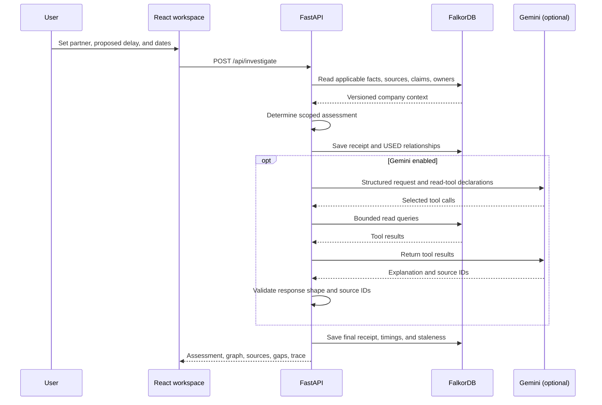

# Architecture

> This page documents the preserved NovaPay payments prototype. The primary company workspace has its own [reference architecture, graph schema and API](DELHIVERY_REFERENCE.md).

[Repository overview](../README.md) · [Graph model](DATA_MODEL.md) · [API contract](API.md)

ChronosGraph is a single-process local application. The interface presents investigations; FastAPI coordinates graph reads, scoped checks, optional model calls, and durable receipts. FalkorDB is the primary knowledge and state store.

## Investigation flow

The diagram summarizes a bounded tool loop; the model may request several calls over up to five generation rounds. It cannot execute arbitrary Cypher or write tools.

## Division of responsibility

| Layer | Owns | Does not establish |
| --- | --- | --- |
| Interface | Explicit scope controls, graph display filter, source inspection, history, repair review | Verdicts or source truth |
| Constraint engine | Supported accepted minima, scoped comparison, documentation differences, missing-evidence handling | General code correctness or deployment safety |
| Gemini investigator | Tool selection and explanation of the supplied context | Authority to change policy or override an assessment |
| Graph store | Parameterized queries, fixtures, temporal assertions, relationships, receipts, actions | Production access control or a native temporal engine |

## Why a graph is operationally necessary here

- Applicability follows `Decision → System` and `Decision → FactVersion → Source`, constrained by partner and both timestamps.
- Document conflicts follow `Document → FactVersion → Source` and compare the modeled values against accepted requirements.
- Reviewer suggestions use `Person → OWNS → System`.
- Saved receipts link back to the facts used. Rehearsal creates a real `GRAPH.COPY` and stores the hypothetical change inside that copy.
- Removing an essential relationship changes the result to insufficient evidence; this is exercised in the integration suite.

The frontend does not maintain a second relationship engine for verdicts. Its decision-context/all-company filter selects visible nodes and edges from API data only.

## State, time, and consistency

Accepted fixture changes increment an **application dataset revision** and conservatively mark all prior receipts stale. A receipt records the revision assessed. Preparing or approving an action from a stale receipt is rejected. This revision is independent of the database client's schema-cache version.

A process-local reentrant lock serializes the current implementation's coordinated operations. The Gemini loop holds that lock while inspecting its stable investigation context. This favors correctness in the small local demo but can delay other operations during model requests. There is no distributed lock, multi-worker guarantee, or crash-atomic transaction across a multi-query ingestion update.

Fact history is modeled by application properties and queries. Owners, topology, source availability, and action approval are not fully versioned across both time axes. See [temporal selection](DATA_MODEL.md#temporal-selection).

## Rehearsal semantics

The server copies the current graph to a random `chronos_scenario_…` key. It records two proposed changes in the copy, preserving A's known minimum when available and applying the requested delay to B. It reruns the same checks, returns a comparison, and deletes that copy in `finally`.

This is a scoped alternative, not a general policy simulator. It does not mutate base accepted facts, predict failures, or infer financial impact. If evidence is missing, preserving a requirement cannot be asserted and the resulting checks retain that uncertainty. `base_unchanged` reports the base revision; an independent copy-isolation test checks the resulting graph behavior too.

## Code map

| File | Reviewer entry point |
| --- | --- |
| [app.py](../backend/chronos/app.py) | HTTP orchestration, stale checks, in-app action handlers, scenario cleanup |
| [models.py](../backend/chronos/models.py) | Partner enumeration, delay bounds, timestamp normalization |
| [engine.py](../backend/chronos/engine.py) | Assessment aggregation, documentary conflicts, receipt contents, draft text |
| [store.py](../backend/chronos/store.py) | Actual Cypher, read/write separation, event replay, graph copying |
| [agent.py](../backend/chronos/agent.py) | Tool declarations, generation budget, response/citation validation |
| [seed.py](../backend/chronos/seed.py) | Fictional company and precise migration history |
| [main.tsx](../frontend/src/main.tsx) | API-backed interface, display-only graph filtering, source inspector |
| [integration tests](../backend/tests/test_company_brain.py) | Business invariants checked against real FalkorDB |

## Technical choices

- **React, TypeScript, Vite:** a browser client for a dedicated FastAPI backend; server-side rendering is unnecessary for the current workflow.
- **FastAPI and Pydantic:** an inspectable HTTP API and explicit request validation.
- **FalkorDB Python client:** real graph reads, persisted state, and scenario copies, using a pinned server image.
- **Google GenAI SDK:** bounded function calling; account-specific model access remains configurable.
- **React Flow:** inspectable relationship maps with source selection and an expanded view.

MCP packaging, multiple agents, live ingestion connectors, and a production permission layer remain roadmap items. They are not implied by the architecture diagram.
