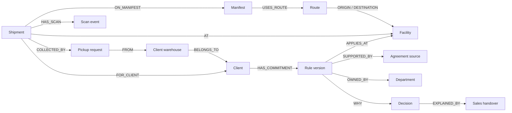

# Database, schema, and data dictionary

[Project overview](../README.md) · [Company walkthrough](DELHIVERY_REFERENCE.md) · [Machine-readable schema](database-schema.json) · [Integration tests](../backend/tests/test_company_reference.py)

## 1. What database do we use?

**FalkorDB is the primary database.** It stores company context, operating records, commitments, source evidence, ownership, saved investigations, and review drafts. The backend reads relationships with parameterized Cypher through `GRAPH.RO_QUERY`; model-selected tools cannot run arbitrary Cypher or obtain credentials.

There is no SQL database behind the main workspace. When this document uses “table equivalent,” it means the familiar relational concept corresponding to a graph label. The implemented objects are **nodes, properties, and directed relationships**.

This document describes an independently designed Delhivery reference prototype. It is **not Delhivery's exact internal database or private schema**. Public business names and logistics concepts are distinguished from synthetic operating records. No private Delhivery agreements, employee records, shipment feeds, warehouse schedules, or client terms were obtained.

## 2. Database topology and persistence

| Graph or component | Purpose | Lifetime / boundary |
| --- | --- | --- |
| `chronos_delhivery_reference_v1` | Shared reference seed, plus a demo-session creation registry | Seeded once; operating knowledge is not changed by visitor replay |
| `chronos_delhivery_demo_<random ID>` | One visitor's company workspace | Persisted; isolated mutations and receipts; opaque capability ID kept in browser local storage |
| `chronos_company_trial_<random ID>` | Before/after rehearsal | Real `GRAPH.COPY`; removed in `finally` after comparison |
| `chronos_reference_test_<random ID>` | Integration-test fixture copies | Disposable; never the user's demo graph |
| `chronos_novapay` or configured legacy name | Preserved payments prototype | Separate from the main company workspace |
| Docker volume `chronosgraph-data` | FalkorDB persistent storage | Mounted at `/var/lib/falkordb/data`; append-only persistence configured in Compose |

`CHRONOS_COMPANY_GRAPH` can change the reference graph name. `FALKOR_GRAPH` controls the legacy payments graph; it does not redirect visitor sessions into that graph. Host, port, optional password and provider keys remain in the ignored root `.env`. No credential belongs in a database diagram or committed export.

Local session creation defaults to a cap of **40** per reference registry, with no automatic expiry. The free Render deployment explicitly sets a cap of **6** and expires registered visitor graphs after **one hour of inactivity**; server restarts also reset hosted visitor data. See [deployment boundaries](DEPLOYMENT.md). No production identity system is implemented. The registry's `DemoSession` records can be inherited by later copies but are excluded from business-entity counts and model exploration. A new workspace preserves earlier active workspaces rather than resetting them.

## 3. Initial dataset size

The deterministic seed contains **9,991 business entities**, **17,207 directed relationships**, and a separate `Metadata` revision record. These are initial fixture counts, not a claim about Delhivery's real scale. Replays, receipts, review packets and session bookkeeping add records.

| Graph label | SQL-table equivalent | Initial rows/nodes | Example ID |
| --- | --- | ---: | --- |
| `Company` | companies | 1 | `delhivery` |
| `Client` | clients | 12 | `havells` |
| `ClientWarehouse` | client_warehouses | 36 | `warehouse-havells` |
| `Facility` | processing_facilities | 14 | `facility-bengaluru` |
| `Team` | departments | 8 | `team-operations` |
| `Route` | transport_lanes | 81 | `lane-00` |
| `Manifest` | manifests | 81 | `manifest-00` |
| `PickupRequest` | pickup_requests | 117 | `pickup-000` |
| `Shipment` | consignments | 1,890 | `shipment-0000` |
| `ScanEvent` | tracking_events | 6,870 | `scan-0000-0` |
| `Rule` | commitment_versions | 43 | `rule-havells-original` |
| `Source` | source_documents | 102 | `source-havells-agreement` |
| `Decision` | decisions | 22 | `decision-sunday` |
| `Policy` | operating_policies | 17 | `policy-schedule` |
| `Campaign` | campaign_context | 13 | `campaign` |
| `Claim` | document_assertions | 25 | `claim-current-schedule` |
| `Ticket` | incident_tickets | 20 | `depth-ticket-cod` |
| `Person` | fictional_role_directory | 24 | `depth-person-0-0` |
| `Vehicle` | fleet_units | 21 | `depth-vehicle-00` |
| `Invoice` | shipping_invoices | 72 | `depth-invoice-000` |
| `CODCollection` | cash_collections | 39 | `depth-cod-0007` |
| `Remittance` | settlement_entries | 39 | `depth-remittance-0007` |
| `Return` | return_requests | 156 | `depth-return-0004` |
| `DeliveryException` | failed_delivery_reviews | 252 | `depth-exception-0003` |
| `WorkItem` | operational_review_work | 36 | `work-havells-operations` |
| `Receipt` | investigation_receipts | 0 | Created by a question |
| `Action` | review_packets | 0 | Created from a current receipt |
| `Event` | applied_demo_events | 0 | Created by replay |
| `DemoSession` | session_registry | 0 | Created in the reference registry |
| `Metadata` | dataset_metadata | 1 | `dataset` |

`Metadata` does not carry `Entity`, so it is outside the 9,991 business-node total. Business statistics exclude `Receipt`, `Action`, and `DemoSession`. The relationship counter includes all `Entity` relationships present, including later receipt links; the initial count has no receipt links.

Seven sources provide curated public context; 95 contain modeled company records. Replaying the amendment adds one source and two rule versions while retaining the original belief.

## 4. Physical storage schema

### Common entity representation

Every business record has the shared label `Entity` and its domain label. A client is `(:Entity:Client)`; a shipment is `(:Entity:Shipment)`.

| Native property | Type | Purpose |
| --- | --- | --- |
| `id` | string | Stable application identifier and relationship lookup key |
| `kind` | string | Allowlisted domain label |
| `title` | string | Human-readable name and searchable summary |
| `payload` | JSON-encoded string | Complete domain record, including the common fields |

All scalar domain fields with safe property names are now mirrored as native FalkorDB properties, including rule values, source availability, shipment status/times, invoice amounts, and custom imported fields. The complete JSON `payload` preserves nested arrays/objects and the full record. `search_text` is a native discovery projection. Runtime `Receipt.stale` and registry creation times are native lifecycle fields; serialized receipts preserve their original context.

### Physical schema v4

- **UNIQUE** on `Entity.id`; **MANDATORY** on `Entity.id`, `kind`, `title`, and `payload`. Actual operational states are visible in the separate inspection portal.
- Range indexes for `Entity.id/kind/title`, `Rule.field/client/subject_id`, `Shipment.client/status`, and `Source.enabled`. Optional indexes may be present even when a custom workspace has no records of that label.
- Temporal predicates use explicit comparison of canonical UTC strings. Integration testing found unsuitable temporal string-index filtering in the pinned configuration; schema v4 removes those indexes and guards date predicates with `toString`. Correctness takes precedence over claiming faster date lookup.
- Versioned migrations add native projections/indexes/constraints without reseeding a workspace, changing its business revision, deleting facts, or clearing history. Failed constraint construction is surfaced rather than marked operational.
- New records include mandatory identity fields at creation. Application relationship writes require existing endpoints. The trusted importer validates source references and accepted-rule support. These are not database-enforced foreign-key or business-domain constraints.

The [separate inspection portal](INSPECTION.md) exposes complete business tables, relationships, observed fields, native properties, structural checks and JSON export. The [general engine](COMPANY_ENGINE.md) discovers the actual workspace schema rather than assuming this reference dataset.

## 5. Domain data dictionary

The fields below appear in decoded records; scalar values are also mirrored natively. Optional fields depend on record type.

| Label | Important fields | Meaning |
| --- | --- | --- |
| `Company` | `description`, `synthetic` | Reference-workspace scope; real business name, independently modeled context |
| `Client` | `sector`, `description`, `synthetic` | Named business identity; private terms and operations remain invented |
| `ClientWarehouse` | `city`, `description` | Synthetic registered collection location, distinct from a processing facility |
| `Facility` | `city`, `facility_type`, `current_sunday_open`, `description` | Synthetic network location; scheduling comparison uses the linked operating policy |
| `Team` | `description` | Department responsibility; no real employee identity or inferred expertise |
| `Route` | `mode`, `schedule` | A synthetic road lane linked to origin and destination facilities |
| `Manifest` | `status` | Planned grouping of consignments associated with a route |
| `PickupRequest` | `status`, `pickup_date` | A collected synthetic pickup request linked to a client warehouse |
| `Shipment` | `client`, `facility`, `arrival_at`, `status`, `description` | November scenario or October snapshot consignment; traversals establish its client and location |
| `ScanEvent` | `event_at`, `sequence`, `description` | Ordered synthetic event in a consignment's history |
| `Rule` | `client`, `facility`, `field`, `value`, `status`, four interval bounds | Accepted temporal commitment; modeled fields include `sunday_processing_required` and four source-supported review controls; values are typed |
| `Source` | `excerpt`, `source_type`, `department`, `timestamp`, `enabled`, `content_hash`, optional `classification`, `url` | Inspectable source text, provenance category, current availability and content hash |
| `Decision` | `description`, `approved` | Accepted decision context or an explicitly unapproved proposal |
| `Policy` | `sunday_required`, `sunday_clients`, `description` | Current handbook configuration; `sunday_clients` drives the baseline Sunday-processing preview |
| `Campaign` | `ended_at`, `description` | Historical reason context; ending a campaign does not modify a commitment |
| `Receipt` | `request`, `summary`, `assessment`, `checks`, `sources`, `graph`, `revision`, `trace`, `mode`, optional provider metadata | Persisted investigation and evidence snapshot |
| `Action` | `receipt_id`, `revision`, `status`, `markdown`, `reviewer` | Source-linked local review draft; not an externally published ticket |
| `Event` | `synthetic` | One-shot replay marker, making the demo event idempotent |

The Finance source additionally stores `full_shift_inr` and `restricted_shift_inr`. These are explicit synthetic assumptions. They do not represent measured company costs or guaranteed savings.

## 6. Relationship schema

Each relationship is directed. The `source_ids` property is a list of supporting `Source.id` values. Empty lists identify synthetic operational links without attached document-level provenance. A hash or source ID is not an authenticity guarantee.

| From | Relationship | To | Meaning |
| --- | --- | --- | --- |
| Client | `PUBLIC_RELATIONSHIP` | Company | Publicly referenced business relationship, not evidence of demo terms |
| Client | `HAS_COMMITMENT` | Rule | Client's versioned processing commitment |
| Rule | `APPLIES_AT` | Facility | Facility scope of a commitment |
| Rule | `SUPPORTED_BY` | Source | Evidence for an accepted requirement |
| Rule | `OWNED_BY` | Team | Department responsible for that commitment |
| Rule | `WHY` | Decision | Recorded rationale context |
| Decision | `EXPLAINED_BY` | Source | Original explanation in a handover record |
| Decision | `SUPPORTED_BY` | Source | Supporting record, including a proposal explicitly marked unapproved |
| Decision | `APPLIES_AT` | Facility | Scope of the proposal |
| Decision | `OWNED_BY` | Team | Decision owner |
| Policy | `APPLIES_AT` | Facility | Scope of current operating instructions |
| Policy | `DOCUMENTED_IN` | Source | Handbook source |
| Policy | `OWNED_BY` | Team | Department maintaining the instructions |
| Facility | `OPERATED_BY` | Team | Current department responsibility |
| Team | `PART_OF` | Company | Organizational membership |
| ClientWarehouse | `BELONGS_TO` | Client | Ownership of the synthetic pickup location |
| PickupRequest | `FROM` | ClientWarehouse | Where the pickup occurred |
| Shipment | `COLLECTED_BY` | PickupRequest | Pickup request associated with the consignment |
| Shipment | `FOR_CLIENT` | Client | Shipment's client |
| Shipment | `AT` | Facility | Fixture's current processing location |
| Shipment | `ON_MANIFEST` | Manifest | Planned movement grouping |
| Manifest | `USES_ROUTE` | Route | Associated transport lane |
| Route | `ORIGIN` / `DESTINATION` | Facility | Lane endpoints |
| Shipment | `HAS_SCAN` | ScanEvent | Tracking history |
| Campaign | `DOCUMENTED_IN` | Source | Campaign handover |
| New Rule | `SUPERSEDES` | Original Rule | Visible replacement lineage introduced by amendment |
| Original Source | `AMENDED_BY` | New Source | Agreement amendment trail |
| Receipt | `USED` | Source | Source used in the company investigation |
| Receipt | `PROPOSES` | Action | Prepared human-review packet |

These are seed conventions, not database-enforced cardinalities. In this fixture each shipment has one client, one current facility, one pickup request, one manifest, and four scans. The model does not imply all real logistics systems use those cardinalities.



## 7. Example records

These examples show decoded payloads. They are not live customer data.

```json
{
  "id": "shipment-0000",
  "kind": "Shipment",
  "title": "DEMO-AWB-000000",
  "synthetic": true,
  "client": "havells",
  "facility": "facility-bengaluru",
  "arrival_at": "2026-11-08T08:00:00Z",
  "status": "received_at_facility"
}
```

```json
{
  "id": "rule-havells-original",
  "kind": "Rule",
  "client": "havells",
  "facility": "facility-bengaluru",
  "field": "sunday_processing_required",
  "value": true,
  "status": "accepted",
  "valid_from": "2026-05-01T00:00:00Z",
  "valid_to": "",
  "recorded_from": "2026-05-02T09:00:00Z",
  "recorded_to": ""
}
```

The initial handbook has `sunday_clients: ["havells"]`. Its Sunday configuration is independent from the agreement versions: an amendment changes what is required, but does not silently rewrite operating instructions.

## 8. Two clocks and amendment history

A rule applies only when:

```text
valid_from <= effective_at < valid_to
recorded_from <= known_at < recorded_to
```

An empty end means no upper bound. The intervals are half-open. API timestamps require a timezone and normalize to UTC. Calendar inputs in the UI use 12:00 UTC.

After the synthetic amendment replay:

| Havells version | Sunday required | Effective interval | Recorded interval |
| --- | --- | --- | --- |
| Original belief | Yes | May 1 onward | May 2 at 09:00 → October 15 at 09:00 |
| Corrected historical commitment | Yes | May 1 → November 1 | October 15 at 09:00 onward |
| Amended commitment | No | November 1 onward | October 15 at 09:00 onward |

Therefore November 8 as known on October 14 still returns the original promise; November 8 as known on October 16 returns the amended requirement. October 25 still requires Sunday processing even after the amendment is recorded.

The query also requires client→rule→facility and rule→source relationships. The engine excludes disabled supporting sources. Missing support or multiple contradictory accepted values yields `insufficient_evidence`. A chat proposal never creates an accepted rule.

Ownership, topology and source availability are not fully versioned. Withdrawing a source affects later historical queries too. The two-clock implementation should not be described as complete historical reconstruction of the company.

## 9. Read-only Cypher examples

These examples match the implemented storage layout. Parameters are supplied separately by the backend; model text is never interpolated into queries.

### Inspect the schema's current population

```cypher
MATCH (n:Entity)
RETURN n.kind, count(n)
ORDER BY n.kind
```

### Find supported temporal commitments

```cypher
MATCH (c:Client)-[:HAS_COMMITMENT]->(r:Rule)
      -[:APPLIES_AT]->(f:Facility {id:'facility-bengaluru'})
MATCH (r)-[:SUPPORTED_BY]->(s:Source)
WHERE r.field='sunday_processing_required'
  AND r.status='accepted'
  AND ($client='all' OR c.id=$client)
  AND r.valid_from <= $effective
  AND (r.valid_to='' OR $effective < r.valid_to)
  AND r.recorded_from <= $known
  AND (r.recorded_to='' OR $known < r.recorded_to)
RETURN c.payload, r.payload, s.payload
LIMIT 30
```

The engine decodes `s.payload` to check `enabled`, and `r.payload` to read `value`. The source node's existence alone is not proof that evidence is available.

### Count affected sample consignments through relationships

```cypher
MATCH (s:Shipment)-[:AT]->(:Facility {id:'facility-bengaluru'})
MATCH (s)-[:FOR_CLIENT]->(c:Client)
WHERE $client='all' OR c.id=$client
RETURN c.id, c.title, count(s)
ORDER BY c.title
```

### Inspect one consignment's ordered scan history

```cypher
MATCH (:Shipment {id:$shipment_id})-[:HAS_SCAN]->(e:ScanEvent)
RETURN e.id, e.payload
ORDER BY e.id
```

The seed's event IDs end in the sequence number. `sequence` and `event_at` are also native properties.

### Trace a recorded reason back to its source

```cypher
MATCH (r:Rule)-[:WHY]->(d:Decision)-[:EXPLAINED_BY]->(s:Source)
WHERE r.id IN $active_rule_ids
RETURN d.payload, s.payload
LIMIT 8
```

### Inspect relationship provenance

```cypher
MATCH (a:Entity {id:$record_id})-[r]->(b:Entity)
RETURN a.id, type(r), b.id, coalesce(r.source_ids, [])
LIMIT 30
```

The actual explorer clamps depth to one or two hops, caps returned records and filters high-volume operational labels out of the general evidence view. Shipment inspection has a separate bounded path for scan and operational neighbors.

## 10. Reads, writes, and invalidation

| Operation | Database behavior |
| --- | --- |
| New workspace | Seeds the reference if absent, copies the graph, records a session registry entry |
| Ask / follow-up | Reads applicable commitments and context; optionally runs bounded Gemini/Groq reads; persists a receipt and `USED` links |
| Expand a node | Reads neighbors and the relationships between returned nodes |
| Approved amendment replay | Updates the original recorded interval, adds two rule versions and amendment evidence, links lineage, increments revision |
| Evidence withdrawal replay | Disables the original supporting source; increments revision |
| Revision change | Marks previous receipts stale conservatively across that workspace |
| Before/after preview | Copies the graph, adds a scenario policy in the copy, reads sample counts and accepted commitments, then deletes only the temporary copy |
| Prepare review packet | Requires a current receipt; writes an `Action` draft and a `PROPOSES` link |

The copy operation has a small bounded retry for a transient “could not fork” failure. It never substitutes a frontend or in-memory clone. Replay operations span multiple writes, coordinated by a process lock; they do not claim crash-atomic transactions or multi-worker coordination.

The model cannot accept policies, replay amendments, approve agreements, change a graph name or publish actions through its read tools. Those application operations remain separate from source text and model explanations.

## 11. Source of truth and reproduction

- [Dataset generator](../backend/chronos/company/seed.py): initial records, sample events and public-reference boundaries.
- [Store](../backend/chronos/company/store.py): labels, native fields, relationships, read templates, graph copies and visitor sessions.
- [Engine](../backend/chronos/company/engine.py): evidence checks, reason paths, handbook review flags, simulation and review drafts.
- [API models](../backend/chronos/company/api.py): request schemas, timestamps and allowlisted events.
- [Investigator](../backend/chronos/company/agent.py): read tools, graph selection and citation bounds.
- [Integration tests](../backend/tests/test_company_reference.py): real-database checks with disposable graphs.

Run `./scripts/check.sh` after completing the [local setup](../README.md#run-locally). It runs the real FalkorDB suite, the preserved payments evaluator, frontend build, and documentation checks without calling either AI provider. Never reset the user's demo graph to run tests.

The [machine-readable dictionary](database-schema.json) is generated from the initial fixture and includes field names/types, counts, representative records, and relationship endpoint types. It is a schema description, not a live runtime export or database-enforced migration.

Regenerate the dictionary directly from the fixture, without a database connection or provider call:

```sh
PYTHONPATH=backend .venv/bin/python scripts/export_schema.py
```

Generator: [export_schema.py](../scripts/export_schema.py).

The logistics fixture includes 25 explicit `Claim` records for handling and billing statements across 12 accounts, linked through `Policy → ASSERTS → Claim → SUPPORTED_BY → Source`. General investigation compares its subject/field/value with applicable accepted rules. Existing reference workspaces receive this fixture extension once and conservatively invalidate earlier receipts; this is separate from the physical schema migration.

See [Synthetic logistics depth](DATA_SCENARIOS.md) for the additional operational, finance, incident and people records, example investigations and limitations.
