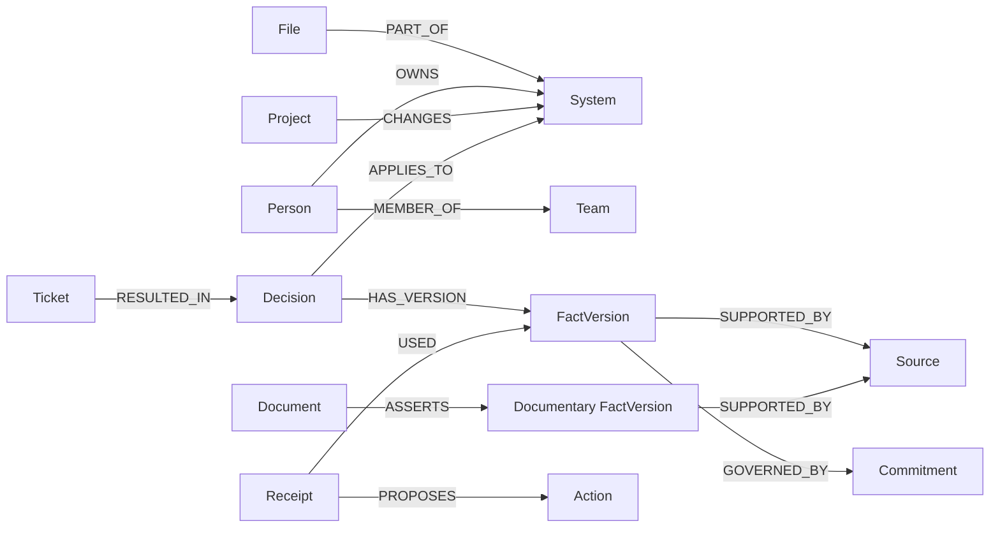

# Graph model and temporal semantics

[Architecture](ARCHITECTURE.md) · [Fixture source](../backend/chronos/seed.py) · [Query implementation](../backend/chronos/store.py)

Every application node carries `Entity` plus its domain label, a stable `id`, `kind`, `title`, and a JSON `payload`. Fact fields needed in queries are also mirrored as native properties. `Metadata` is a separate revision record. This design keeps the prototype easy to inspect; it does not yet enforce a full database constraint/index schema.

## Main relationships



Other fixture edges include `Decision → SUPPORTED_BY → Source`, `System → DEPENDS_ON → System`, `Project → DOCUMENTED_IN → Source`, and `FactVersion → SUPERSEDES → FactVersion`. A rehearsal creates `Change → MODIFIES → File` inside its temporary copy. The seed and store are the source of truth for actual labels and edges; the diagram is a focused subset.

## Node responsibilities

| Label | Relevant properties and role |
| --- | --- |
| `System`, `File` | Stable affected service and repository path; the current target is fixed to the payment worker. |
| `Person`, `Team`, `Project` | Company ownership and context. Ownership lookup is implemented; competence or availability is not inferred. |
| `Decision` | Durable decision identity and approval metadata. Replay proposals do not receive accepted fact versions. |
| `FactVersion` | Subject, field, value, partner, status, and valid/recorded intervals. |
| `Source` | Excerpt, source type, timestamp, synthetic label, and current availability. Main seed/migration sources have content hashes; this is not an end-to-end authenticity guarantee. |
| `Commitment` | Partner-specific governing requirement. |
| `Document`, `Ticket` | Runbook claim and incident context. |
| `Receipt` | Scope, checks, supporting sources, graph snapshot, gaps, trace, revision, timing, and model mode. |
| `Action` | Repair Markdown, reviewer, receipt reference, and draft/approved-in-app status. |
| `Event` | One-shot sample-event marker used for idempotency. |
| `Metadata` | Current application dataset revision. |

## Temporal selection

A fact is selected only when both conditions hold:

```text
valid_from <= effective_at < valid_to
recorded_from <= known_at < recorded_to
```

Intervals are half-open. An empty end denotes no upper bound. API timestamps are normalized into consistent UTC strings. Seed timestamps follow the same format so lexical comparisons are valid.

The accepted-fact query additionally checks subject, modeled field, partner, and `accepted` status, and requires the decision/system and fact/source relationships. The engine then excludes currently withdrawn sources. Zero supported values or multiple different supported values produce insufficient evidence for that partner.

## The late-arriving migration

Partner B migrates effective **October 10, 2026, 00:00 UTC**. The company records that approval on **October 12, 2026, 09:00 UTC**.

| B fact version | Value | Effective interval | Recorded interval |
| --- | --- | --- | --- |
| Original belief | 250 ms | April 4 onward | April 4 at 10:00 → October 12 at 09:00 |
| Corrected historical requirement | 250 ms | April 4 → October 10 | October 12 at 09:00 onward |
| Migrated requirement | 0 ms | October 10 onward | October 12 at 09:00 onward |

The original belief remains available for an “as known then” query. A `SUPERSEDES` edge helps inspection, but interval predicates actually determine selection. Partner A's accepted 250 ms minimum is unchanged.

For October 11:

- Known by October 11: select 250 ms.
- Known by October 15: select 0 ms.

## Aggregation and conflict boundaries

A proposed delay below the single supported minimum conflicts. Meeting or exceeding that minimum produces `no_known_conflict` for that modeled field. Across partners, any conflict takes precedence; otherwise missing evidence takes precedence over no known conflict. Per-partner checks preserve the distinction.

The runbook detector compares its applicable per-partner documentary value with the supported accepted minimum. It does not perform general contradiction detection over arbitrary prose. Replay accepts a specific predefined migration; it is not an extraction or organizational approval engine for uploaded chats.

## Limits a reviewer should know

- Source availability is a current flag. Withdrawal affects subsequent historical queries too; historical source-access or retraction timelines are not modeled.
- Ownership and service topology are static fixture relationships. Historical requirement support does not imply historical ownership support.
- Event replay spans multiple graph writes. A process lock coordinates successful operations but does not provide crash rollback.
- Receipt snapshots are audit aids, not signed or tamper-evident records.
- A commitment edge gives company context; the current minimum check is selected through decision/fact/source relationships. Arbitrary missing commitment data is not independently treated as a legal-compliance failure.
