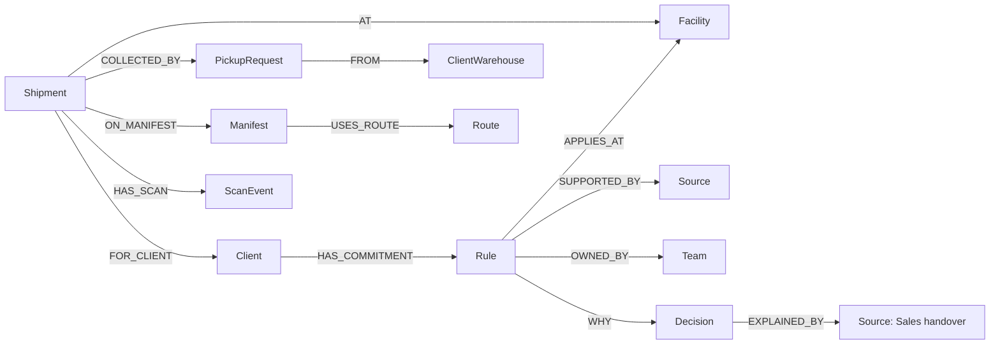

# Delhivery reference workspace

ChronosGraph investigates **why an operating decision exists, whether its commitment still applies, and what a proposed change would do**. The primary example is Sunday processing at a Bengaluru facility.

## Public facts versus synthetic records

Delhivery is a real logistics business. Its public [service description](https://www.delhivery.com/services/express-parcel), [order lifecycle](https://help.delhivery.com/docs/update-forward-order), and [developer FAQ](https://one.delhivery.com/developer-portal/document/b2c/detail/faq) inform the entity types and workflow. Its [press archive](https://www.delhivery.com/company/press-release) lists business relationships with Havells India, HPCL and SUGAR Cosmetics.

**This is an independent reference implementation, not Delhivery's internal system or exact private schema.** Public relationships do not establish the demo's agreements. Every facility record, consignment, scan, department responsibility, conversation, cost and operating commitment is synthetic. No actual customer incident, agreement, employee identity or live logistics integration is represented.

## The operating story

Operations wants to close Bengaluru on Sundays. A synthetic Havells service agreement requires Sunday processing; SUGAR and HPCL have six-day processing. A Sales handover records a weekend campaign as the reason. Ending the campaign does not amend the agreement. An Operations chat is a proposal, not an approval.

A separately replayed approved **demo amendment** changes Havells to six-day processing effective **November 1, 2026**, recorded **October 15, 2026 at 09:00 UTC**. Both clocks matter. The existing handbook remains a separate record for human review.

## Start and explore

Follow the [root setup](../README.md#run-locally), then open `http://127.0.0.1:5173/`.

1. Ask **Can we close the Bengaluru facility on Sundays?** The original agreement produces a Havells conflict.
2. Read the small evidence trail. Each row is a real relationship; click a record or connection to inspect it. Switch to **Map** for a spatial view.
3. Select a commitment and ask **Why does this exist?**, **Does this still apply?**, or a custom follow-up. **Explore connections** performs another bounded graph read. Exploration can show historical records; inspect their intervals.
4. Replay **Introduce approved amendment**. Existing receipts become stale. Rerun for November 8, known by October 16: no modeled Sunday conflict remains.
5. Change the effective date to October 25: Havells still requires Sunday processing. Change the knowledge cutoff to October 14: the original belief remains available even for a November effective date.
6. Open **Before & after**, run comparison, and toggle **Full proposal / Preserve commitments**. The real graph copy is discarded after the calculation; base knowledge stays unchanged.
7. Prepare and download a source-linked review packet from a current investigation. No external ticket or operating change is made.
8. Search **Company records** for `DEMO-AWB-000001`, a source title or a department. Operational records have bounded graph inspection too.

The AI investigator is enabled by default for new browser sessions when a server key is configured. Gemini is preferred, with Groq used when Gemini cannot complete the run. The successful provider, mode and tool trace are displayed. Graph-only search is explicitly labeled; its intent handling is limited to this workflow. Failure of both configured providers preserves the deterministic checks and displays a generic explanation. Natural language does not grant arbitrary database access or write authority.

For the full field dictionary, physical storage layout, relational equivalents, lifecycle rules and Cypher examples, see [Database & schema](DATABASE.md).

## Dataset and schema

The initial seed has **6,153 business entities and 9,775 relationships**, including:

| Graph label | Count | Meaning |
| --- | ---: | --- |
| Company | 1 | Public business identity |
| Client | 3 | Real organization names; synthetic operating commitments |
| Facility | 8 | Synthetic processing-centre records |
| ClientWarehouse | 3 | Synthetic registered pickup locations |
| Team | 8 | Department responsibilities, not real employee identities |
| Route | 24 | Synthetic outbound Bengaluru lanes |
| Manifest | 24 | Planned lane-linked manifests |
| PickupRequest | 60 | Synthetic collected pickup requests |
| Shipment | 1,200 | Consignments in the Sunday scenario |
| ScanEvent | 4,800 | Four ordered synthetic events per consignment |
| Rule | 3 | Accepted, temporally scoped Sunday commitments |
| Source | 15 | Four public references plus eleven synthetic records |
| Decision | 2 | Accepted decision and unapproved proposal |
| Policy | 1 | Current demo handbook configuration |
| Campaign | 1 | Synthetic reason context |

The replay adds source and rule versions. Counts come from FalkorDB, not frontend constants. Receipts and review packets are additional persisted entities. IDs prefixed `DEMO` are not live waybills.

## Temporal semantics

Rules use half-open valid and recorded intervals. Original belief remains queryable before the amendment was recorded. The corrected historical version ends November 1; the amended version starts then. An enabled supporting source and the graph relationships are required for a supported result. Missing, withdrawn or contradictory evidence yields insufficient evidence, rather than permission to close.

Source availability is a current flag. Ownership and network topology are current synthetic relationships, not historical versions. “Before” in the comparison means current demo configuration, not a reconstruction of the historical operating system.

## Simulation boundaries

The 1,200 Sunday fixture arrivals are replayed on the first Sunday on or after the selected effective date. Commitments are checked for that scenario date. The current handbook processes Havells on Sunday and queues the other clients. Full closure queues all selected fixture arrivals for Monday. The scoped alternative preserves supported Sunday exceptions and refuses to infer missing requirements.

The Finance source supplies shift-cost assumptions. Figures are not measured Delhivery costs, guaranteed savings or full staffing/transport forecasts. Processing is not delivery: the comparison does not predict customer experience, actual vehicle capacity, delivery dates or outages.

## Architecture and API

[Company store](../backend/chronos/company/store.py), [engine](../backend/chronos/company/engine.py), [Investigator tools](../backend/chronos/company/agent.py), [API](../backend/chronos/company/api.py), and [fixture](../backend/chronos/company/seed.py) are separate from the preserved NovaPay implementation.

The immutable reference graph is `chronos_delhivery_reference_v1` by default. Each visitor receives an opaque random ID and a real graph copy named `chronos_delhivery_demo_…`. Local storage retains only that demo session ID. Session mutations never target the original payments graph. Scenario copies use `chronos_company_trial_…` and are deleted in `finally`.

| POST route | Purpose |
| --- | --- |
| `/api/company/session` | Create or reopen a session; return stats, initial graph, sources and receipts |
| `/api/company/ask` | Investigate a question with optional focus, client and two dates |
| `/api/company/explore` | Inspect a record and bounded neighbors |
| `/api/company/search` | Search records through a parameterized template |
| `/api/company/simulate` | Compare rules in a disposable graph copy |
| `/api/company/events` | Replay the allowlisted synthetic amendment or source withdrawal |
| `/api/company/packet` | Prepare a review draft from a current receipt |

Read tools call `GRAPH.RO_QUERY`; the model receives neither credentials nor arbitrary Cypher execution. Tool, argument, record-ID and citation bounds are enforced. Citation membership is not semantic proof. The model may still require human review.

## Hosting boundary

This implementation is running locally unless a deployment is separately linked. Sessions are synthetic-demo capabilities, not authentication or enterprise tenant isolation. The server caps reference-session creation at 40; sessions persist and no automatic expiry is claimed. Public deployment still requires infrastructure, provider spend/rate controls, lifecycle management and a review of the preserved legacy mutation routes. A single-process lock coordinates graph operations and currently serializes model calls. No high-concurrency or production readiness claim is made.

The original payments workflow remains at `/?demo=payments`. Its model and API documentation are marked as legacy scope.
